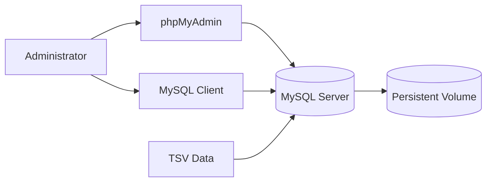

# SkyConnect-DB

**Relational Airport Database Management System**

[Overview](#overview) ·
[Features](#features) ·
[Architecture](#architecture) ·
[Roadmap](#roadmap) ·
[Security](#security) ·
[Documentation](#documentation)

---

## Overview

SkyConnect-DB is an educational database engineering project
focused on designing and implementing a relational database
management system for a fictional international airport.

The project explores the complete database development lifecycle,
from conceptual modeling to SQL implementation, bulk data
imports, query optimization, access control and transactional
data integrity.

Developed as part of an individual IT project at ETML,
Switzerland.

## Features

- Airport and airline management
- Aircraft fleet management
- Aircraft type classification
- Recurring flight schedules
- Actual flight operations
- Passenger management
- Flight and seat reservations
- Bulk TSV data imports
- Advanced SQL queries
- Database index optimization
- Role-based access control
- ACID transaction management

These features represent the planned project scope.

## Technology Stack

| Technology | Purpose |
|------------|---------|
| MySQL | Relational database engine |
| Docker | Containerized infrastructure |
| Docker Compose | Service orchestration |
| phpMyAdmin | Database administration |
| Looping | MERISE database modeling |
| SQL | Database operations |
| Git | Version control |
| GitHub | Source code management |

## Architecture

### Database

- Database name: `db_aeroport`
- Database engine: MySQL
- Target storage engine: InnoDB

### Core entities

- Airport
- Airline
- Aircraft type
- Aircraft
- Flight schedule
- Flight
- Passenger
- Reservation

The final database schema will be published after
the conceptual and logical models have been validated.

## Roadmap

- [ ] Requirements analysis
- [ ] Conceptual data model
- [ ] Logical data model
- [ ] Teacher validation
- [ ] Database implementation
- [ ] TSV data import
- [ ] 15 mandatory SQL queries
- [ ] Index analysis and optimization
- [ ] Database roles and privileges
- [ ] Transaction management
- [ ] Integrity and security testing
- [ ] Final technical documentation

## Security

The database is designed around the principle
of least privilege.

Five user profiles are planned:

| Role | Responsibilities |
|------|------------------|
| Administrator | Full database administration |
| Flight Manager | Flight planning and management |
| Reservation Agent | Passengers and reservations |
| Check-in Agent | Reservation verification and seat updates |
| Analyst | Read-only database access |

Credentials, sensitive datasets and personal information
must never be committed to this repository.

## Performance

Database performance will be evaluated through:

- Existing index analysis
- Composite index design
- Query execution plans
- Index selectivity
- SQL query optimization

Performance results will be documented after testing.

## Transactions

The project includes two transactional use cases:

1. Flight cancellation and reservation removal.
2. Seat availability verification and reservation creation.

The objective is to preserve database consistency
and prevent invalid or orphaned records.

## Documentation

The technical documentation will cover:

- Database modeling
- Installation and configuration
- SQL queries and explanations
- Data import verification
- Performance analysis
- Security configuration
- Transaction management
- Development journal
- AI usage disclosure

## Project Status

This repository is currently under development.

Implementation and validation results will be added
progressively throughout the project.

## AI Usage

AI-assisted tools may be used for planning, documentation,
SQL development, debugging and technical explanations.

All generated content must be reviewed and understood.
Actual AI usage will be documented in the project report.

---

### Author

**RufusTheDwarf**

Developed for educational purposes.

Thank you for exploring this project.

