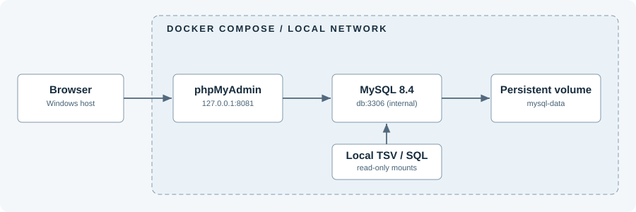
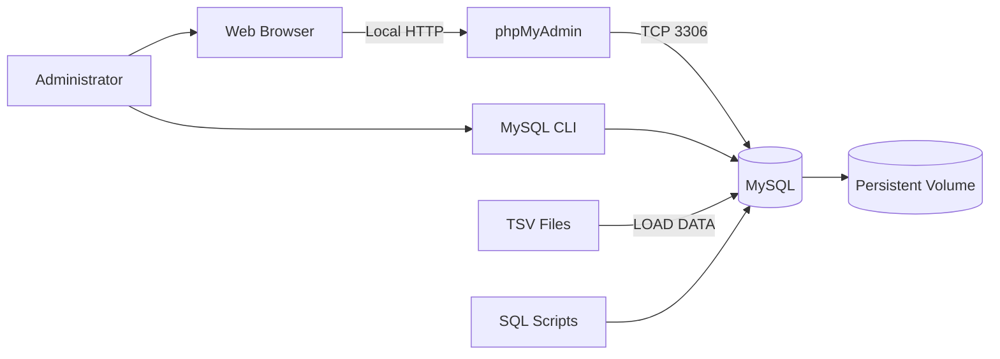
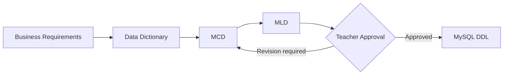
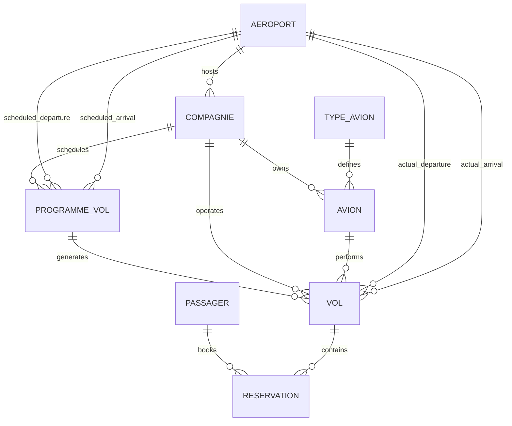
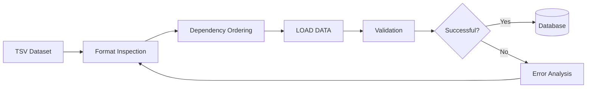
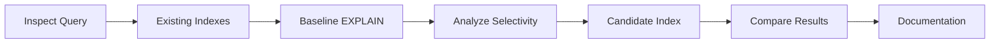
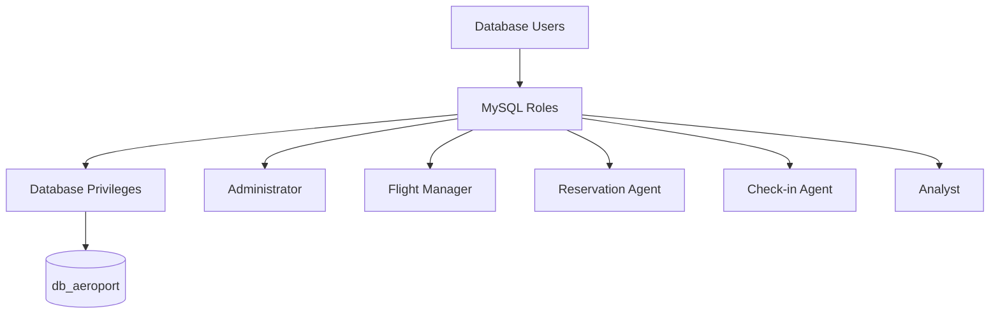
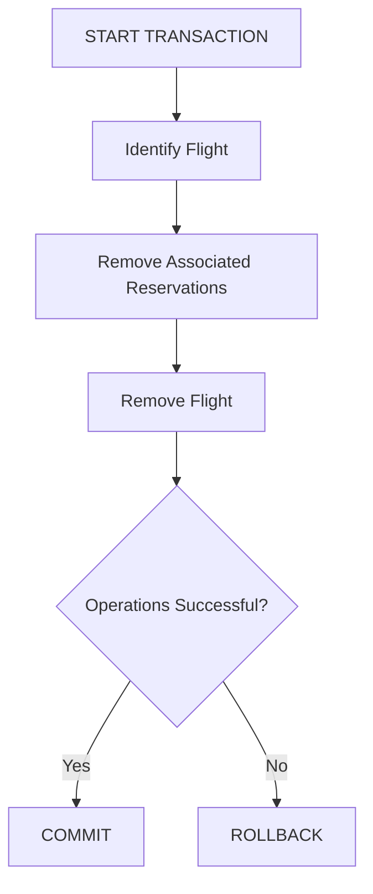
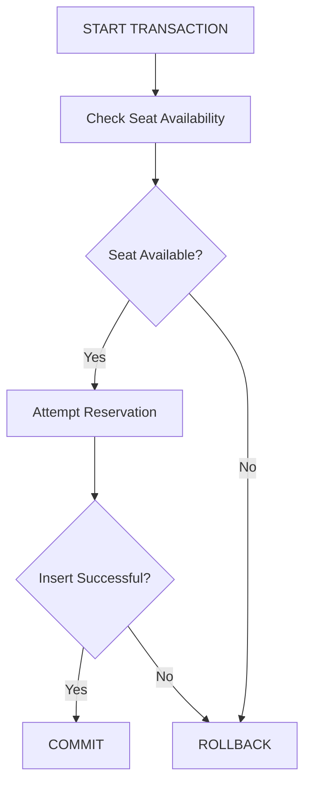
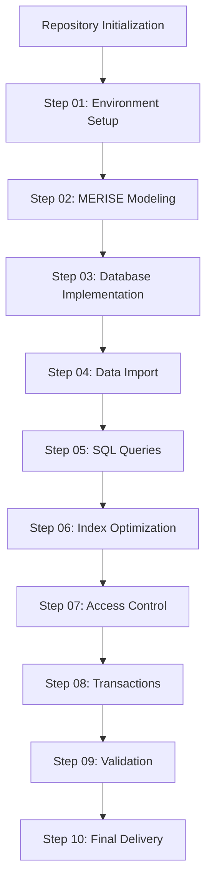

<div align="center">

  <a name="top"></a>

  

  <h3>Relational Airport Database Management System</h3>

  <p>
    <strong>Design · Build · Secure · Optimize</strong>
  </p>

  <p>
    
    
    
    
    
    
  </p>

  <p>
    
    
    
    
    
  </p>

  <p>
    
    
    
    
    
    
    
  </p>

  <p>
    
    
    
    
    
    
  </p>

  <p>
    <a href="https://github.com/RufusTheDwarf/SkyConnect-DB/stargazers">
      
    </a>
    <a href="https://github.com/RufusTheDwarf/SkyConnect-DB/forks">
      
    </a>
    <a href="https://github.com/RufusTheDwarf/SkyConnect-DB/issues">
      
    </a>
    <a href="https://github.com/RufusTheDwarf/SkyConnect-DB/pulls">
      
    </a>
    
    
    
  </p>

  <p>
    
    
    
    
    
  </p>

  <br />

  <p>
    <a href="#overview">Overview</a> ·
    <a href="#architecture">Architecture</a> ·
    <a href="#repository">Repository</a> ·
    <a href="#step-01">Installation</a> ·
    <a href="#step-02">Modeling</a> ·
    <a href="#step-03">Implementation</a>
  </p>

  <p>
    <a href="#step-04">Data Import</a> ·
    <a href="#step-05">SQL Queries</a> ·
    <a href="#step-06">Indexes</a> ·
    <a href="#step-07">Security</a> ·
    <a href="#step-08">Transactions</a>
  </p>

  <p>
    <a href="#step-09">Testing</a> ·
    <a href="#step-10">Documentation</a> ·
    <a href="#roadmap">Roadmap</a> ·
    <a href="#references">References</a> ·
    <a href="#developer">Developer</a>
  </p>

</div>

---

<a name="overview"></a>

<div align="center">

  <h2>SkyConnect-DB</h2>

  
  
  

</div>

**SkyConnect-DB** is an individual educational project focused on designing, implementing, administering, securing and optimizing a relational database for a fictional international airport.

The project covers the complete lifecycle of a relational database, from business requirements and conceptual modeling to SQL development, bulk data ingestion, performance optimization and transactional integrity.

Developed as part of the IT curriculum at ETML, Lausanne, Switzerland.

### Project scope

| Component | Description |
| :--- | :--- |
| Airports | International airports and identification codes |
| Airlines | Airline operators and operational bases |
| Aircraft types | Aircraft models and descriptions |
| Aircraft | Individual aircraft and passenger capacity |
| Flight schedules | Recurring flight programs |
| Flights | Actual flight operations |
| Passengers | Passenger identification |
| Reservations | Ticket prices and seat assignments |

### Project objectives

- Design a relational database using the MERISE methodology.
- Create conceptual and logical data models.
- Implement the approved database schema in MySQL.
- Import large datasets using SQL bulk-loading operations.
- Develop and document fifteen mandatory SQL queries.
- Analyze indexes and optimize database performance.
- Configure database users, roles and privileges.
- Implement transactional operations.
- Validate data integrity and access restrictions.
- Produce complete and reproducible technical documentation.

> [!IMPORTANT]
> SkyConnect-DB is currently under development.
>
> The repository contains the initial infrastructure, documentation
> and SQL scaffold. The final database schema, query solutions,
> imported datasets and validation results are still pending.
>
> The conceptual and logical data models must be approved by the
> teacher before database table creation.

---

<div align="center">

  <h2>Technology Stack</h2>

  

  <br /><br />

  
  
  

</div>

| Technology | Version / Standard | Purpose |
| :--- | :--- | :--- |
| [MySQL](https://www.mysql.com/) | 8.4 LTS series | Relational database engine |
| InnoDB | MySQL storage engine | Referential integrity and transactions |
| [Docker](https://www.docker.com/) | Compatible installation | Containerized infrastructure |
| [Docker Compose](https://docs.docker.com/compose/) | Compose CLI | Service orchestration |
| [phpMyAdmin](https://www.phpmyadmin.net/) | 5.2 series | Database administration |
| [Looping](https://www.looping-mcd.fr/) | School-approved version | MERISE modeling |
| SQL | MySQL dialect | Database operations |
| PowerShell | Windows | Local administration |
| Git | Version control | Development history |
| GitHub | Repository platform | Source code management |
| YAML | Configuration format | Infrastructure definition |
| Markdown | GFM | Technical documentation |
| SVG | Vector graphics | Visual documentation |
| TSV | Tab-separated values | Dataset exchange |

> [!NOTE]
> Docker image tags track release series rather than immutable
> image digests. Compatibility with the school environment
> must be confirmed before deployment.

---

<a name="architecture"></a>

<div align="center">

  <h2>System Architecture</h2>

  
  
  
  

  <br /><br />

  

</div>

The infrastructure uses two Docker services connected through a dedicated bridge network.

MySQL stores its data in a Docker-managed persistent volume. phpMyAdmin provides a local web administration interface.

### Communication flow



### Infrastructure configuration

| Parameter | Value |
| :--- | :--- |
| Compose project | `skyconnect` |
| Database service | `db` |
| Database image | `mysql:8.4` |
| Administration service | `phpmyadmin` |
| Administration image | `phpmyadmin:5.2` |
| Database name | `db_aeroport` |
| MySQL internal port | `3306/tcp` |
| phpMyAdmin default port | `8081/tcp` |
| Host binding | `127.0.0.1` |
| Docker network | `backend` |
| Network driver | `bridge` |
| Persistent volume | `mysql-data` |
| Target storage engine | `InnoDB` |

### Infrastructure security

| Security control | Configuration |
| :--- | :--- |
| MySQL host exposure | Not published |
| phpMyAdmin exposure | Local loopback interface |
| Credentials | Local `.env` file |
| Dataset access | Read-only bind mount |
| SQL file access | Read-only bind mount |
| Import restrictions | `secure_file_priv` |
| Startup dependency | MySQL health check |
| Data persistence | Named Docker volume |

> [!WARNING]
> This infrastructure is intended for local educational use.
> It is not a hardened production deployment and must not
> be exposed directly to the internet.

See [architecture documentation](docs/architecture.md).

---

<a name="repository"></a>

<div align="center">

  <h2>Repository Structure</h2>

  
  
  

</div>

```text
SkyConnect-DB/
│
├── .github/
│   └── ISSUE_TEMPLATE/
│       ├── bug_report.md
│       └── feature_request.md
│
├── assets/
│   ├── badges/
│   │   ├── docker.svg
│   │   ├── merise.svg
│   │   ├── mysql.svg
│   │   ├── phpmyadmin.svg
│   │   ├── sql.svg
│   │   └── status.svg
│   │
│   ├── diagrams/
│   │   └── architecture.svg
│   │
│   ├── header.svg
│   └── footer.svg
│
├── database/
│   ├── schema/
│   │   ├── 01_create_database.sql
│   │   └── 02_create_tables.sql
│   │
│   ├── imports/
│   │   └── load_data.sql
│   │
│   ├── queries/
│   │   ├── README.md
│   │   ├── query_01.sql
│   │   ├── query_02.sql
│   │   ├── query_03.sql
│   │   ├── query_04.sql
│   │   ├── query_05.sql
│   │   ├── query_06.sql
│   │   ├── query_07.sql
│   │   ├── query_08.sql
│   │   ├── query_09.sql
│   │   ├── query_10.sql
│   │   ├── query_11.sql
│   │   ├── query_12.sql
│   │   ├── query_13.sql
│   │   ├── query_14.sql
│   │   └── query_15.sql
│   │
│   ├── indexes/
│   │   ├── README.md
│   │   ├── analyze_indexes.sql
│   │   └── create_indexes.sql
│   │
│   ├── security/
│   │   ├── README.md
│   │   ├── 01_create_roles.sql
│   │   ├── 02_grant_privileges.sql
│   │   ├── 03_create_users.sql
│   │   └── 04_assign_roles.sql
│   │
│   └── transactions/
│       ├── README.md
│       ├── cancel_flight.sql
│       └── seat_reservation.sql
│
├── data/
│   └── README.md
│
├── docs/
│   ├── modeling/
│   │   ├── README.md
│   │   └── data_dictionary.md
│   │
│   ├── screenshots/
│   │   └── README.md
│   │
│   ├── report/
│   │   └── README.md
│   │
│   ├── ai-usage.md
│   ├── architecture.md
│   ├── installation.md
│   ├── journal.md
│   ├── requirements.md
│   └── security.md
│
├── tests/
│   ├── README.md
│   ├── integrity_tests.sql
│   ├── security_tests.sql
│   └── transaction_tests.sql
│
├── .editorconfig
├── .env.example
├── .gitattributes
├── .gitignore
├── compose.yaml
├── CHANGELOG.md
├── LICENSE
└── README.md
```

| Directory | Responsibility |
| :--- | :--- |
| `.github/` | Issue templates |
| `assets/` | SVG banners, badges and diagrams |
| `database/schema/` | Database and table definitions |
| `database/imports/` | Bulk data import scripts |
| `database/queries/` | Fifteen SQL exercises |
| `database/indexes/` | Index analysis and optimization |
| `database/security/` | Database access control |
| `database/transactions/` | Transactional operations |
| `data/` | Local datasets excluded from Git |
| `docs/` | Technical documentation |
| `tests/` | Validation and testing procedures |

---

<a name="step-01"></a>

<div align="center">

  <h2>Step 01 // Environment Setup</h2>

  
  
  
  
  

</div>

### Prerequisites

Install or verify the following tools:

| Tool | Requirement |
| :--- | :--- |
| Docker Desktop | Linux containers mode |
| Docker Compose | Compatible Compose CLI |
| Git | Repository management |
| Looping | Database modeling |
| Web browser | phpMyAdmin access |
| PowerShell | Local administration |

Verify the installation:

```powershell
docker --version
docker compose version
git --version
```

### Clone the repository

```powershell
git clone https://github.com/RufusTheDwarf/SkyConnect-DB.git
cd SkyConnect-DB
```

### Configure the environment

```powershell
Copy-Item .env.example .env
notepad .env
```

Configure the local variables:

```dotenv
MYSQL_ROOT_PASSWORD=
PMA_HTTP_PORT=8081
```

Set a unique and non-empty password.

Change the phpMyAdmin port if `8081` is already occupied.

> [!CAUTION]
> Never commit the `.env` file or actual database credentials.

### Validate the configuration

```powershell
docker compose config --quiet
```

### Start the environment

```powershell
docker compose up -d
docker compose ps
```

Inspect the database logs:

```powershell
docker compose logs --tail=100 db
```

### Access phpMyAdmin

Open the following address in a web browser:

**[http://127.0.0.1:8081](http://127.0.0.1:8081)**

| Parameter | Value |
| :--- | :--- |
| Username | `root` |
| Password | Configured in `.env` |
| Database host | `db` |
| Database name | `db_aeroport` |

The root account is reserved for initial administration.

### Access MySQL

```powershell
docker compose exec db mysql -u root -p
```

Verify the database environment:

```sql
SELECT VERSION();

SHOW DATABASES;

USE db_aeroport;

SHOW TABLES;
```

The initial environment creates the empty database.
No unapproved tables are automatically deployed.

### Docker command reference

| Command | Purpose |
| :--- | :--- |
| `docker compose up -d` | Start services |
| `docker compose ps` | Display service status |
| `docker compose logs db` | Inspect database logs |
| `docker compose logs phpmyadmin` | Inspect administration logs |
| `docker compose stop` | Stop containers |
| `docker compose start` | Start existing containers |
| `docker compose restart` | Restart services |
| `docker compose down` | Remove containers and network |
| `docker compose images` | Display service images |

### Shutdown

```powershell
docker compose down
```

The named database volume is preserved.

> [!CAUTION]
> The `docker compose down -v` command deletes the persistent
> database volume and its stored data. Do not use it as
> a routine shutdown command.

### Completion checklist

- [ ] Verify Docker installation.
- [ ] Configure environment variables.
- [ ] Validate Compose configuration.
- [ ] Start both containers.
- [ ] Verify MySQL connectivity.
- [ ] Verify phpMyAdmin connectivity.
- [ ] Confirm database initialization.

**Documentation:** [Installation guide](docs/installation.md)

---

<a name="step-02"></a>

<div align="center">

  <h2>Step 02 // Database Modeling</h2>

  
  
  
  
  

</div>

**Assignment reference:** Section 7.3.1

The MERISE methodology separates business requirements,
conceptual modeling, logical modeling and physical implementation.

### Modeling workflow



### Preliminary database entities

| Entity | Proposed table |
| :--- | :--- |
| Airport | `t_aeroport` |
| Airline | `t_compagnie` |
| Aircraft type | `t_type_avion` |
| Aircraft | `t_avion` |
| Flight schedule | `t_programme_vol` |
| Flight | `t_vol` |
| Passenger | `t_passager` |
| Reservation | `t_reservation` |

The final model may introduce additional entities or associative tables.

### Preliminary relational model



> [!NOTE]
> This diagram is a preliminary interpretation of the business domain.
> It does not replace the official MCD and MLD created with Looping.

### Business rules

| ID | Business rule |
| :--- | :--- |
| BR-01 | Airport ICAO codes must be unique |
| BR-02 | Airport IATA codes are not unique according to the assignment |
| BR-03 | Each airline has a principal operational airport |
| BR-04 | Each aircraft belongs to an airline |
| BR-05 | Each aircraft has an associated aircraft type |
| BR-06 | Aircraft capacity belongs to the individual aircraft |
| BR-07 | Flight schedules do not require an assigned aircraft |
| BR-08 | Each actual flight follows a flight schedule |
| BR-09 | Each actual flight has an assigned aircraft |
| BR-10 | Actual flight routes may differ from scheduled routes |
| BR-11 | Passenger passport numbers must be unique |
| BR-12 | Reservations associate passengers with actual flights |
| BR-13 | Reservations include a seat assignment and a price |

Preventing duplicate seat assignments on the same flight
is an additional proposed integrity requirement.

### Completion checklist

- [ ] Analyze the assignment requirements.
- [ ] Identify entities and attributes.
- [ ] Complete the data dictionary.
- [ ] Define relationships.
- [ ] Define cardinalities.
- [ ] Create the MCD in Looping.
- [ ] Generate the MLD.
- [ ] Obtain teacher approval.

> [!IMPORTANT]
> Teacher approval is mandatory before proceeding with
> database table creation.

### Resources

| File | Purpose |
| :--- | :--- |
| [Modeling guide](docs/modeling/README.md) | MERISE modeling workflow |
| [Data dictionary](docs/modeling/data_dictionary.md) | Business attributes and rules |
| [Requirements](docs/requirements.md) | Assignment traceability |

---

<a name="step-03"></a>

<div align="center">

  <h2>Step 03 // Database Implementation</h2>

  
  
  
  
  
  

</div>

**Assignment reference:** Section 7.3.2

After the conceptual and logical models have been approved,
the database schema can be exported from Looping and
implemented in MySQL.

### Database creation

```sql
CREATE DATABASE IF NOT EXISTS db_aeroport;

USE db_aeroport;
```

### Schema deployment

Export the approved SQL schema from Looping and place it in:

```text
database/schema/02_create_tables.sql
```

Review the generated SQL before executing it.

Inside the MySQL client:

```sql
USE db_aeroport;

SOURCE /workspace/database/schema/02_create_tables.sql;

SHOW TABLES;
```

### Integrity mechanisms

| Mechanism | Purpose |
| :--- | :--- |
| `PRIMARY KEY` | Unique row identification |
| `FOREIGN KEY` | Referential integrity |
| `UNIQUE` | Business uniqueness |
| `NOT NULL` | Required attributes |
| `CHECK` | Domain validation |
| Appropriate data types | Consistency and storage efficiency |
| InnoDB | Transactions and foreign key enforcement |

### Schema verification

```sql
SHOW TABLES;

SELECT
    TABLE_NAME,
    ENGINE
FROM information_schema.TABLES
WHERE TABLE_SCHEMA = 'db_aeroport';
```

### Completion checklist

- [ ] Export approved SQL from Looping.
- [ ] Review generated table definitions.
- [ ] Verify data types.
- [ ] Verify primary keys.
- [ ] Verify foreign keys.
- [ ] Verify uniqueness constraints.
- [ ] Execute the approved schema.
- [ ] Document the created tables.

### Resources

| File | Purpose |
| :--- | :--- |
| [01_create_database.sql](database/schema/01_create_database.sql) | Database initialization |
| [02_create_tables.sql](database/schema/02_create_tables.sql) | Approved table definitions |

---

<a name="step-04"></a>

<div align="center">

  <h2>Step 04 // Data Import</h2>

  
  
  
  
  

</div>

**Assignment reference:** Section 7.3.3

All datasets provided by the teacher must be imported into
the corresponding database tables using `LOAD DATA`.

### Import workflow



### Directory configuration

| Environment | Path |
| :--- | :--- |
| Host datasets | `./data/` |
| Container datasets | `/var/lib/mysql-files/` |
| SQL scripts | `/workspace/database/` |

### Import preparation

Before importing a dataset, verify:

- File encoding.
- Field delimiter.
- Line endings.
- Header presence.
- Column order.
- NULL representation.
- Expected record count.
- Foreign key dependencies.

### Import configuration verification

```sql
SHOW VARIABLES LIKE 'secure_file_priv';
```

### Import validation

```sql
SHOW WARNINGS;
```

Row counts must also be compared with the source dataset
using the appropriate `COUNT(*)` query for each table.

### Acceptance criteria

| Metric | Expected result |
| :--- | :--- |
| Source records | All accounted for |
| Imported records | Match expected dataset |
| Skipped records | `0` |
| Warnings | `0` |
| Referential integrity | Valid |
| Data consistency | Valid |
| Import evidence | Screenshot for every command |

The final `LOAD DATA` statements depend on the actual
TSV format and the approved database schema.

### Completion checklist

- [ ] Obtain the teacher-provided datasets.
- [ ] Inspect all file formats.
- [ ] Determine the correct import order.
- [ ] Prepare SQL import statements.
- [ ] Import all datasets.
- [ ] Verify record counts.
- [ ] Confirm zero skipped records.
- [ ] Confirm zero warnings.
- [ ] Capture screenshots.
- [ ] Document every import command.

### Resources

- [Import script](database/imports/load_data.sql)
- [Dataset documentation](data/README.md)
- [Evidence management](docs/screenshots/README.md)

---

<a name="step-05"></a>

<div align="center">

  <h2>Step 05 // SQL Query Development</h2>

  
  
  
  
  
  
  

</div>

**Assignment reference:** Section 7.3.4

The SQL query library contains fifteen individual exercises
covering fundamental and advanced database operations.

### Query library

| ID | Description | Technical concepts | Source |
| :---: | :--- | :--- | :---: |
| Q01 | Top two aircraft by capacity for airline ID 60 | `WHERE`, `ORDER BY`, `LIMIT` | [SQL](database/queries/query_01.sql) |
| Q02 | Three latest flights by departure time | `ORDER BY`, `LIMIT` | [SQL](database/queries/query_02.sql) |
| Q03 | Total flight count per airline | `COUNT`, `GROUP BY` | [SQL](database/queries/query_03.sql) |
| Q04 | Passenger information and departure airport | `JOIN` | [SQL](database/queries/query_04.sql) |
| Q05 | Average reservation price per flight | `AVG`, `GROUP BY` | [SQL](database/queries/query_05.sql) |
| Q06 | All airports and associated airlines | `LEFT JOIN` | [SQL](database/queries/query_06.sql) |
| Q07 | All airlines and their aircraft counts | `LEFT JOIN`, `COUNT` | [SQL](database/queries/query_07.sql) |
| Q08 | Top five airlines with at least 1500 flights | `HAVING`, `LIMIT` | [SQL](database/queries/query_08.sql) |
| Q09 | Flight count by airline and departure airport | `JOIN`, `GROUP BY` | [SQL](database/queries/query_09.sql) |
| Q10 | Total aircraft capacity by airline and model | `SUM`, `GROUP BY` | [SQL](database/queries/query_10.sql) |
| Q11 | Airlines without aircraft | Subquery, `NOT EXISTS` | [SQL](database/queries/query_11.sql) |
| Q12 | Scheduled departures from Montpellier | Filtering and relationships | [SQL](database/queries/query_12.sql) |
| Q13 | Passport number format validation | `REGEXP`, conditional aggregation | [SQL](database/queries/query_13.sql) |
| Q14 | Flight number pattern matching | `REGEXP` | [SQL](database/queries/query_14.sql) |
| Q15 | Airlines with more than two long-haul aircraft | `REGEXP`, `JOIN`, `HAVING` | [SQL](database/queries/query_15.sql) |

### SQL competency matrix

| Category | Concepts |
| :--- | :--- |
| Data retrieval | `SELECT`, `FROM` |
| Filtering | `WHERE`, `AND`, `OR` |
| Sorting | `ORDER BY`, `ASC`, `DESC` |
| Result limitation | `LIMIT` |
| Relationships | `JOIN`, `LEFT JOIN` |
| Aggregation | `COUNT`, `SUM`, `AVG` |
| Grouping | `GROUP BY`, `HAVING` |
| Conditional logic | `CASE` |
| Subqueries | `NOT EXISTS`, nested `SELECT` |
| Pattern matching | `REGEXP` |
| Aliasing | `AS` |
| Data validation | Conditional aggregation |

### SQL formatting convention

```sql
SELECT
    C.nom AS compagnie,
    COUNT(V.vol_id) AS nombre_vols
FROM t_compagnie AS C
JOIN t_vol AS V
    ON C.compagnie_id = V.compagnie_fk
GROUP BY
    C.compagnie_id,
    C.nom
ORDER BY
    nombre_vols DESC;
```

This query illustrates the intended formatting convention.
It is not presented as a validated exercise result.

### Development rules

- Write SQL keywords in uppercase.
- Use explicit `AS` aliases.
- Prefer `JOIN` over `INNER JOIN`.
- Prefer `LEFT JOIN` over `LEFT OUTER JOIN`.
- Use meaningful column aliases.
- Follow the approved database naming conventions.
- Document important technical concepts.
- Validate every query against the imported datasets.

### Completion checklist

- [ ] Implement queries 01 to 05.
- [ ] Implement queries 06 to 10.
- [ ] Implement queries 11 to 15.
- [ ] Verify all query results.
- [ ] Explain the important SQL concepts.
- [ ] Include every query in the report.

**Documentation:** [SQL query library](database/queries/README.md)

---

<a name="step-06"></a>

<div align="center">

  <h2>Step 06 // Index Optimization</h2>

  
  
  
  
  
  

</div>

**Assignment reference:** Section 7.3.5

Database indexes improve access efficiency but introduce
additional storage and maintenance costs.

The optimization phase focuses on two mandatory queries.

### Optimization workflow



### Query 01

```sql
SELECT
    V.vol_id,
    V.heure_depart,
    V.heure_arrivee,
    C.nom AS compagnie
FROM t_vol AS V
JOIN t_compagnie AS C
    ON V.compagnie_fk = C.compagnie_id
WHERE
    V.compagnie_fk = 3
    AND V.heure_depart > '12:00:00'
ORDER BY
    V.heure_depart DESC;
```

### Query 02

```sql
SELECT
    A.nom AS aeroport,
    COUNT(V.vol_id) AS nombre_vols
FROM t_vol AS V
JOIN t_aeroport AS A
    ON V.aeroport_depart_fk = A.aeroport_id
WHERE
    V.heure_depart > '10:00:00'
GROUP BY
    A.nom
ORDER BY
    nombre_vols DESC;
```

### Inspect existing indexes

```sql
SHOW INDEX FROM t_vol;

SHOW INDEX FROM t_compagnie;

SHOW INDEX FROM t_aeroport;
```

### Indexing concepts

| Concept | Description |
| :--- | :--- |
| Primary index | Index associated with a primary key |
| Unique index | Enforces uniqueness |
| Secondary index | Additional data access structure |
| Composite index | Contains multiple indexed columns |
| Covering index | Contains all columns required by a query |
| Selectivity | Ability to restrict matching records |
| Cardinality | Estimated number of distinct indexed values |
| Leftmost prefix | Usable leading columns of a composite index |
| Range scan | Index traversal across a range of values |
| Full table scan | Sequential examination of table records |

### Candidate indexes

| Query | Candidate index |
| :--- | :--- |
| Query 01 | `(compagnie_fk, heure_depart)` |
| Query 02 | `(heure_depart, aeroport_depart_fk)` |

These are preliminary candidates, not validated recommendations.

For Query 01, placing the equality predicate first
and the range predicate second is a logical starting point.

For Query 02, the usefulness of an index beginning with
`heure_depart` depends on the selectivity of the filter
and the execution plan chosen by MySQL.

An index beginning with `aeroport_depart_fk` may also
be worth evaluating depending on data distribution.

### Benchmark results

| Metric | Before | After |
| :--- | :---: | :---: |
| Query 01 execution time | Pending | Pending |
| Query 01 rows examined | Pending | Pending |
| Query 01 selected index | Pending | Pending |
| Query 02 execution time | Pending | Pending |
| Query 02 rows examined | Pending | Pending |
| Query 02 selected index | Pending | Pending |

> [!IMPORTANT]
> Index performance must be measured using actual execution plans.
> No performance improvement is claimed before validation.

### Completion checklist

- [ ] Inspect primary key indexes.
- [ ] Inspect foreign key indexes.
- [ ] Record baseline execution plans.
- [ ] Analyze predicate selectivity.
- [ ] Evaluate composite index column order.
- [ ] Identify redundant indexes.
- [ ] Create justified indexes.
- [ ] Compare execution plans.
- [ ] Document the results.

### Resources

- [Index documentation](database/indexes/README.md)
- [Index analysis](database/indexes/analyze_indexes.sql)
- [Index creation](database/indexes/create_indexes.sql)

---

<a name="step-07"></a>

<div align="center">

  <h2>Step 07 // Users & Access Control</h2>

  
  
  
  
  
  

</div>

**Assignment reference:** Section 7.3.6

The database security model follows Role-Based Access Control
and the principle of least privilege.

Each employee must receive only the permissions necessary
to perform their assigned responsibilities.

### Database roles

| Role | Proposed identifier | Responsibility |
| :--- | :--- | :--- |
| Administrator | `role_admin` | Complete database administration |
| Flight Manager | `role_flight_manager` | Flight planning and modification |
| Reservation Agent | `role_reservation_agent` | Passenger and reservation management |
| Check-in Agent | `role_checkin_agent` | Reservation verification and seat modification |
| Analyst | `role_analyst` | Read-only database analysis |

### Proposed privilege matrix

| Operation | Admin | Flight Manager | Reservation Agent | Check-in Agent | Analyst |
| :--- | :---: | :---: | :---: | :---: | :---: |
| Read flights | Yes | Yes | Yes | Yes | Yes |
| Create flights | Yes | Yes | No | No | No |
| Update flights | Yes | Yes | No | No | No |
| Delete flights | Yes | No | No | No | No |
| Read passengers | Yes | No | Yes | Yes | Yes |
| Create passengers | Yes | No | Yes | No | No |
| Update passengers | Yes | No | Yes | No | No |
| Read reservations | Yes | No | Yes | Yes | Yes |
| Create reservations | Yes | No | Yes | No | No |
| Update reservations | Yes | No | Yes | Limited | No |
| Update assigned seats | Yes | No | Yes | Yes | No |
| Delete reservations | Yes | No | No | No | No |
| Manage users | Yes | No | No | No | No |
| Manage privileges | Yes | No | No | No | No |

The proposed policy must be adapted to the final schema
and the precise operational requirements.

### Access control architecture



### Implementation order

| Order | Operation | SQL concept |
| :---: | :--- | :--- |
| 1 | Create database roles | `CREATE ROLE` |
| 2 | Grant role privileges | `GRANT` |
| 3 | Create individual accounts | `CREATE USER` |
| 4 | Assign roles | `GRANT role` |
| 5 | Activate default roles | `SET DEFAULT ROLE` |
| 6 | Inspect privileges | `SHOW GRANTS` |
| 7 | Verify active roles | `CURRENT_ROLE()` |
| 8 | Test authorized operations | Positive testing |
| 9 | Test unauthorized operations | Negative testing |

### Security verification

```sql
SHOW GRANTS;

SELECT CURRENT_ROLE();
```

### Sensitive information

Never commit:

- Database credentials.
- Authentication tokens.
- Private keys.
- Real passport numbers.
- Personal passenger information.
- Restricted educational datasets.
- Unredacted screenshots.
- Database backups containing sensitive records.

> [!CAUTION]
> Adding a file to `.gitignore` does not remove it from Git history.
> Rotate any credentials that have been accidentally committed.

### Completion checklist

- [ ] Create all five roles.
- [ ] Define appropriate privileges.
- [ ] Create at least one user per role.
- [ ] Assign roles to users.
- [ ] Configure role activation.
- [ ] Verify authorized operations.
- [ ] Verify unauthorized operations.
- [ ] Document the security configuration.

### Resources

| File | Purpose |
| :--- | :--- |
| [01_create_roles.sql](database/security/01_create_roles.sql) | Role creation |
| [02_grant_privileges.sql](database/security/02_grant_privileges.sql) | Privilege configuration |
| [03_create_users.sql](database/security/03_create_users.sql) | User creation |
| [04_assign_roles.sql](database/security/04_assign_roles.sql) | Role assignment |
| [Security documentation](docs/security.md) | Access control policies |

---

<a name="step-08"></a>

<div align="center">

  <h2>Step 08 // Transaction Management</h2>

  
  
  
  
  

</div>

**Assignment reference:** Section 7.3.7

Transactions preserve database consistency when multiple
related operations must be executed as a single logical unit.

### ACID properties

| Property | Description |
| :--- | :--- |
| Atomicity | All related operations succeed together or are rolled back |
| Consistency | Transactions preserve defined database rules |
| Isolation | Concurrent operations follow transaction isolation guarantees |
| Durability | Committed changes persist after supported failure scenarios |

### Case 01: Flight cancellation

When a flight is cancelled, all associated reservations
must be removed without leaving orphaned records.



The implementation must account for foreign key constraints
and transactional error handling.

**Source:** [cancel_flight.sql](database/transactions/cancel_flight.sql)

### Case 02: Seat reservation

The provided transaction must be analyzed to explain
seat availability verification and reservation creation.



A preliminary availability check alone does not guarantee
that concurrent transactions cannot reserve the same seat.

A unique constraint covering the flight and seat combination
is a proposed integrity mechanism that must be evaluated
with appropriate transaction error handling.

MySQL procedural `IF` statements also require a suitable
stored-program context.

**Source:** [seat_reservation.sql](database/transactions/seat_reservation.sql)

### Completion checklist

- [ ] Analyze flight cancellation requirements.
- [ ] Implement reservation removal.
- [ ] Implement flight removal.
- [ ] Configure transaction error handling.
- [ ] Explain the provided reservation transaction.
- [ ] Analyze concurrent reservation risks.
- [ ] Verify rollback behavior.
- [ ] Verify referential integrity.
- [ ] Document both transaction cases.

---

<a name="step-09"></a>

<div align="center">

  <h2>Step 09 // Testing & Validation</h2>

  
  
  
  
  

</div>

Database quality must be established through reproducible
validation procedures rather than successful execution alone.

### Test matrix

| ID | Test | Expected result |
| :--- | :--- | :--- |
| ENV-01 | Compose configuration | Valid configuration |
| ENV-02 | MySQL startup | Healthy service |
| ENV-03 | phpMyAdmin connectivity | Successful connection |
| DB-01 | Database initialization | Database exists |
| DB-02 | Approved schema deployment | All required tables exist |
| INT-01 | Duplicate primary key | Rejected |
| INT-02 | Invalid foreign key | Rejected |
| INT-03 | Duplicate passport | Rejected |
| INT-04 | Duplicate flight seat | Rejected if the proposed constraint is adopted |
| DATA-01 | Imported record counts | Expected counts |
| DATA-02 | Import warnings | Zero warnings |
| DATA-03 | Skipped records | Zero skipped records |
| SQL-01 | Mandatory SQL exercises | Correct results |
| PERF-01 | Baseline execution plans | Recorded |
| PERF-02 | Optimized execution plans | Compared |
| SEC-01 | Authorized operations | Accepted |
| SEC-02 | Unauthorized operations | Denied |
| SEC-03 | Analyst write attempt | Denied |
| SEC-04 | Check-in reservation deletion | Denied |
| TX-01 | Flight cancellation | No orphaned reservations |
| TX-02 | Transaction rollback | Previous state preserved |
| TX-03 | Concurrent seat reservation | Duplicate assignment prevented |

### Test files

| File | Coverage |
| :--- | :--- |
| [integrity_tests.sql](tests/integrity_tests.sql) | Constraints and consistency |
| [security_tests.sql](tests/security_tests.sql) | Privileges and restrictions |
| [transaction_tests.sql](tests/transaction_tests.sql) | Transaction behavior |
| [Test documentation](tests/README.md) | Validation strategy |

### Current validation status

| Component | Status |
| :--- | :--- |
| Infrastructure configuration | Prepared |
| MCD and MLD | Pending |
| Database schema | Pending |
| Data import | Pending |
| SQL query validation | Pending |
| Performance benchmarks | Pending |
| Security validation | Pending |
| Transaction validation | Pending |

No successful runtime tests or performance improvements
are claimed at the current development stage.

### Completion checklist

- [ ] Verify infrastructure.
- [ ] Verify database constraints.
- [ ] Validate imported datasets.
- [ ] Verify all SQL queries.
- [ ] Validate database privileges.
- [ ] Test transaction behavior.
- [ ] Record actual test results.
- [ ] Document identified problems and corrections.

---

<a name="step-10"></a>

<div align="center">

  <h2>Step 10 // Documentation & Final Delivery</h2>

  
  
  
  
  

</div>

Every mandatory project stage must be documented
in the final technical report.

### General documentation

| Document | Description |
| :--- | :--- |
| [Requirements](docs/requirements.md) | Assignment requirements |
| [Installation](docs/installation.md) | Deployment and troubleshooting |
| [Architecture](docs/architecture.md) | Infrastructure design |
| [Security](docs/security.md) | Database access control |
| [Journal](docs/journal.md) | Development history |
| [AI usage](docs/ai-usage.md) | AI-assisted development disclosure |
| [Changelog](CHANGELOG.md) | Repository evolution |

### Database documentation

| Document | Description |
| :--- | :--- |
| [Modeling](docs/modeling/README.md) | MERISE workflow |
| [Data dictionary](docs/modeling/data_dictionary.md) | Business attributes |
| [Data import](data/README.md) | Dataset management |
| [SQL queries](database/queries/README.md) | Mandatory exercises |
| [Indexes](database/indexes/README.md) | Performance optimization |
| [Database security](database/security/README.md) | Access control implementation |
| [Transactions](database/transactions/README.md) | Transactional operations |
| [Testing](tests/README.md) | Validation strategy |

### Project report

The report must include:

- Project introduction.
- Requirements analysis.
- Conceptual and logical data models.
- Database table definitions.
- Data import commands.
- Screenshots of successful imports.
- Fifteen SQL queries and technical explanations.
- Index selection and justification.
- Database roles and privileges.
- Transaction management.
- AI usage disclosure.

**Report outline:** [docs/report/README.md](docs/report/README.md)

### AI-assisted development

Artificial intelligence tools are permitted within the
educational project framework.

Their actual contributions must be documented, including
the tools used and the purpose of each contribution.

AI assistance may include:

- Requirements analysis.
- Database modeling assistance.
- SQL explanations.
- Infrastructure configuration.
- Code review.
- Debugging.
- Documentation.
- Security and performance analysis.

The project author remains responsible for understanding,
reviewing, testing and validating all generated material.

**AI disclosure:** [docs/ai-usage.md](docs/ai-usage.md)

### Completion checklist

- [ ] Complete all mandatory assignment stages.
- [ ] Document technical decisions.
- [ ] Add required screenshots to the private report.
- [ ] Document actual AI usage.
- [ ] Review database security.
- [ ] Verify documentation consistency.
- [ ] Review repository contents.
- [ ] Finalize the technical report.

---

<div align="center">

  <h2>Backup & Recovery</h2>

  
  
  
  

</div>

Persistent Docker volumes are not a replacement for backups.

Create a database backup before destructive operations,
major imports or structural modifications.

### Create a backup

Open a shell inside the database container:

```powershell
docker compose exec db sh
```

Run the backup command:

```sh
mysqldump -u root -p --single-transaction --routines --triggers db_aeroport > /tmp/db_aeroport.sql
```

Exit the container:

```sh
exit
```

Create a local backup directory and copy the database dump:

```powershell
New-Item -ItemType Directory -Force backups

docker compose cp db:/tmp/db_aeroport.sql backups/db_aeroport.sql
```

Inspect the backup file:

```powershell
Get-Item backups/db_aeroport.sql
```

Remove the temporary container copy:

```powershell
docker compose exec db rm /tmp/db_aeroport.sql
```

A complete backup procedure requires a successful restoration
test in an isolated environment.

> [!CAUTION]
> Database backups may contain sensitive passenger information.
> Store them securely and never commit them to Git.

---

<div align="center">

  <h2>Troubleshooting</h2>

  
  
  

</div>

| Problem | Possible cause | Recommended action |
| :--- | :--- | :--- |
| Docker unavailable | Docker Desktop stopped | Start Docker Desktop |
| Compose configuration fails | Missing environment variable | Verify `.env` |
| MySQL keeps restarting | Initialization error | Inspect database logs |
| phpMyAdmin unavailable | Port conflict | Verify host port and container status |
| Access denied | Invalid password or privileges | Verify authentication |
| New `.env` password rejected | Existing volume retains previous credentials | Rotate the existing MySQL password properly |
| Import denied | Invalid path or import restriction | Verify `secure_file_priv` |
| Foreign key violation | Incorrect import order | Import referenced records first |
| Import warnings | Dataset format mismatch | Inspect `SHOW WARNINGS` |
| Duplicate key error | Duplicate records | Investigate conflicting values |
| Slow query | Inefficient access path | Analyze execution plans |
| Missing privileges | Role not activated | Inspect default and active roles |

### Docker diagnostics

```powershell
docker compose ps

docker compose logs --tail=100 db

docker compose logs --tail=100 phpmyadmin

docker compose config --quiet
```

### MySQL diagnostics

```sql
SELECT VERSION();

SHOW DATABASES;

SHOW TABLES;

SHOW WARNINGS;

SHOW GRANTS;

SELECT CURRENT_ROLE();

SHOW VARIABLES LIKE 'secure_file_priv';
```

Additional guidance is available in the
[installation documentation](docs/installation.md).

---

<a name="roadmap"></a>

<div align="center">

  <h2>Development Roadmap</h2>

  
  
  

</div>



### Project progress

| Milestone | Status |
| :--- | :--- |
| Repository scaffold |  |
| Environment setup |  |
| MERISE modeling |  |
| Database implementation |  |
| Data import |  |
| SQL query development |  |
| Index optimization |  |
| Users and roles |  |
| Transactions |  |
| Testing |  |
| Final report |  |

---

<div align="center">

  <h2>Development Standards</h2>

  
  
  
  

</div>

### Naming conventions

| Object | Convention | Example |
| :--- | :--- | :--- |
| Database | `db_` prefix | `db_aeroport` |
| Table | `t_` prefix | `t_vol` |
| Primary key | `_id` suffix | `vol_id` |
| Foreign key | `_fk` suffix | `compagnie_fk` |
| Index | `idx_` prefix | `idx_vol_compagnie_depart` |
| Unique constraint | `uq_` prefix | `uq_reservation_vol_siege` |
| Role | `role_` prefix | `role_analyst` |
| SQL file | Lowercase snake case | `query_01.sql` |

Naming conventions remain subject to the approved logical model.

### Conventional commits

| Prefix | Purpose |
| :--- | :--- |
| `feat:` | New functionality |
| `fix:` | Bug correction |
| `docs:` | Documentation changes |
| `perf:` | Performance improvements |
| `test:` | Validation and testing |
| `refactor:` | Internal restructuring |
| `style:` | Formatting changes |
| `chore:` | Repository maintenance |
| `build:` | Infrastructure configuration |
| `ci:` | Continuous integration |

### Commit examples

```bash
git commit -m "chore: initialize SkyConnect database project"

git commit -m "docs: add conceptual database model"

git commit -m "feat: implement approved relational schema"

git commit -m "feat: add TSV data import scripts"

git commit -m "perf: optimize flight query indexes"

git commit -m "feat: implement database access control"

git commit -m "test: validate transaction integrity"
```

### Engineering principles

| Principle | Application |
| :--- | :--- |
| KISS | Keep implementation understandable |
| DRY | Avoid unnecessary duplication |
| YAGNI | Avoid unnecessary functionality |
| Least privilege | Restrict database permissions |
| Integrity | Preserve valid database relationships |
| Reproducibility | Document deployment procedures |
| Maintainability | Separate SQL operations by responsibility |
| Traceability | Track changes and technical decisions |

---

<a name="references"></a>

<div align="center">

  <h2>Technical References</h2>

  
  
  

</div>

### Database engineering

| Resource | Documentation |
| :--- | :--- |
| MySQL | [MySQL 8.4 Reference Manual](https://dev.mysql.com/doc/refman/8.4/en/) |
| InnoDB | [InnoDB Storage Engine](https://dev.mysql.com/doc/refman/8.4/en/innodb-storage-engine.html) |
| SQL imports | [LOAD DATA](https://dev.mysql.com/doc/refman/8.4/en/load-data.html) |
| Indexes | [Optimization and Indexes](https://dev.mysql.com/doc/refman/8.4/en/optimization-indexes.html) |
| Execution plans | [EXPLAIN](https://dev.mysql.com/doc/refman/8.4/en/explain.html) |
| Security | [MySQL Security](https://dev.mysql.com/doc/refman/8.4/en/security.html) |
| Roles | [Using Roles](https://dev.mysql.com/doc/refman/8.4/en/roles.html) |
| Transactions | [Transactional Statements](https://dev.mysql.com/doc/refman/8.4/en/sql-transactional-statements.html) |

### Infrastructure and tooling

| Resource | Documentation |
| :--- | :--- |
| Docker | [Official Documentation](https://docs.docker.com/) |
| Docker Compose | [Compose Documentation](https://docs.docker.com/compose/) |
| MySQL image | [Docker Hub](https://hub.docker.com/_/mysql) |
| phpMyAdmin image | [Docker Hub](https://hub.docker.com/_/phpmyadmin) |
| phpMyAdmin | [Documentation](https://docs.phpmyadmin.net/) |
| Looping | [Official Website](https://www.looping-mcd.fr/) |
| Git | [Documentation](https://git-scm.com/doc) |
| GitHub | [Documentation](https://docs.github.com/) |
| Conventional Commits | [Specification](https://www.conventionalcommits.org/) |

---

<div align="center">

  <h2>Contributions & Feedback</h2>

  
  
  

  <br /><br />

  SkyConnect-DB is an individual educational project.

  Technical feedback, documentation improvements and discussions
  about database engineering practices are welcome.

  External contributions must respect the academic requirements
  and must not replace the author's individual work.

  <br />

  <a href="https://github.com/RufusTheDwarf/SkyConnect-DB/issues">
    
  </a>

  <a href="https://github.com/RufusTheDwarf/SkyConnect-DB">
    
  </a>

</div>

---

<div align="center">

  <h2>License</h2>

  <a href="LICENSE">
    
  </a>

</div>

The original source code and documentation created for
this repository are distributed under the MIT License.

See the [LICENSE](LICENSE) file for more information.

The license does not automatically cover third-party
software, teacher-provided datasets, restricted educational
documents or personal information.

Third-party resources retain their respective licenses.

---

<a name="developer"></a>

<div align="center">

  <h2>Developer</h2>

  <a href="https://github.com/RufusTheDwarf">
    
  </a>

  <h3>RufusTheDwarf</h3>

  <p>
    <strong>IT · Software Engineering · Infrastructure · Open Source</strong>
  </p>

  <p>
    
    
    
    
    
  </p>

  <p>
    <a href="https://github.com/RufusTheDwarf">
      
    </a>
    <a href="https://github.com/RufusTheDwarf?tab=repositories">
      
    </a>
  </p>

  <p>
    
  </p>

  <br />

  <h3>Acknowledgements</h3>

  <p>
    Thanks to ETML, the teaching staff and the open-source
    communities maintaining the technologies used in this project.
  </p>

  <p>
    Special thanks to the MySQL, Docker, phpMyAdmin,
    Git and GitHub communities.
  </p>

  <br />

  

  <br /><br />

  <p>
    <strong>Build with purpose. Learn continuously. Share knowledge.</strong>
  </p>

  <p>
    Thank you for exploring SkyConnect-DB.
  </p>

  <a href="https://github.com/RufusTheDwarf/SkyConnect-DB/stargazers">
    
  </a>

  <br /><br />

  <a href="#top">
    
  </a>

  <br /><br />

  <sub>
    Educational project · ETML · Lausanne, Switzerland · 2026
  </sub>

  <br /><br />

  

</div>
