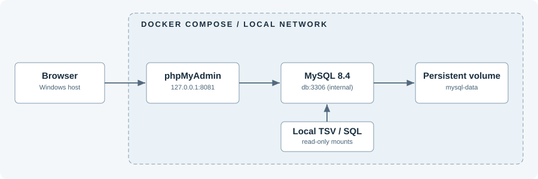

# Architecture

- Host: Windows with Docker and Looping.
- `db`: MySQL 8.4, internal TCP 3306, no host port.
- `phpmyadmin`: web administration, loopback only (default 8081), connects to `db` by Compose DNS.
- `mysql-data`: persistent named volume.
- `data/`: read-only mount `/var/lib/mysql-files` for server-side imports.
- `database/`: read-only mount `/workspace/database` for manual SQL execution.

This is a local educational topology, not a hardened production deployment. The readiness probe checks server responsiveness, not authentication or schema completeness. Versions and topology are scaffold choices, not assignment requirements.
